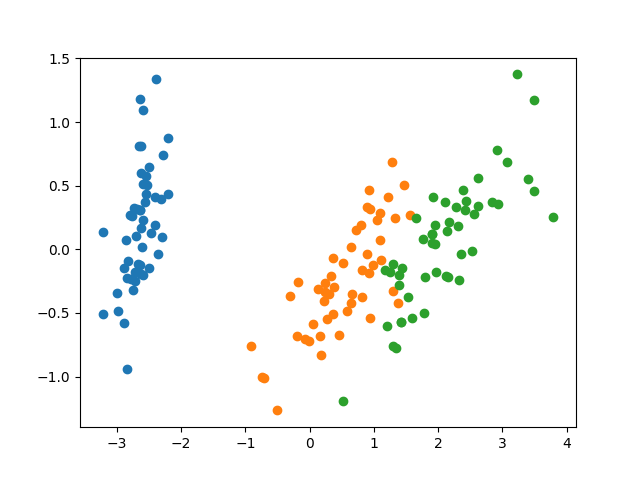

+++
title = "Sklearn"
+++

[Docs](https://scikit-learn.org/stable/modules/generated/sklearn.decomposition.PCA.html)

```python
# Load dataset
from sklearn.datasets import load_iris
iris = load_iris()
data = iris.data  # (150, 4)
target = iris.target  # (150, 1)

# --- PCA --- #
from sklearn.decomposition import PCA
pca = PCA(n_components=2)
data = pca.fit_transform(data)  # (150, 2)
# ----------- #

# Plot
import matplotlib.pyplot as plt
points = {0: [], 1: [], 2: []}
for i in range(len(target)):
    points[target[i]].append(data[i])

for label, dat in points.items():
    x, y = zip(*dat)
    plt.scatter(x, y, label=label)

plt.plot()
```


